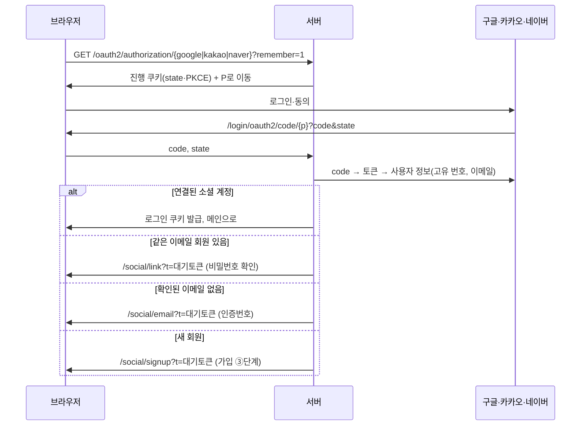

# 구현 계획 (Implementation Plan): 소셜 로그인

**명세**: [spec.md](spec.md) · **결정**: D-125 · **브랜치**: `feature/social-login`

## 기술 맥락

- Spring Boot 3.5, Spring Security, `spring-boot-starter-oauth2-client`를 더한다.
- 구글은 OpenID Connect(`openid email`), 카카오·네이버는 OAuth2(사용자 정보 API)로 붙인다. 카카오·네이버는 Spring에 기본 설정이 없어 `application.yml`에 provider(인가·토큰·사용자 정보 주소)를 직접 적는다.
- 로그인 뒤에는 지금의 JWT + HttpOnly 쿠키를 그대로 발급한다(D-53, D-61, D-82). 서버 세션은 쓰지 않는다.
- OAuth2 진행 중 요청 정보(state, PKCE, 로그인 유지 여부, 돌아갈 화면)는 세션 대신 서명·암호화한 짧은 쿠키(10분)에 둔다. 서버를 늘려도(4.3) 그대로 동작한다.
- 가입·연결을 기다리는 소셜 계정 정보는 DB 표 `social_pendings`에 두고, 브라우저에는 무작위 토큰만 준다(SCL-01, 메모리에 두지 않음).
- 이메일 직접 입력(FR-016)은 기존 `email_verifications`와 메일 발송을 그대로 쓴다.

## 헌법 확인

| 원칙 | 확인 |
|---|---|
| 보안 | state·PKCE 확인, 소셜 접근 토큰 저장 안 함, 비밀번호 확인에 기존 잠금·사람 확인 적용 |
| 블로그별 역할 | 바뀌지 않음(로그인 정보에는 회원 번호만) |
| 개인정보 | 소셜에서 이메일·고유 번호만 저장, 연결 확인 창의 이메일은 서버에서 가림(D-22) |
| 이중화 대비 | 진행 정보는 쿠키, 대기 정보는 DB |
| 설정값 | 앱 키·만료 시간은 환경 변수(D-68) |

## 흐름

## 데이터

[data-model.md](data-model.md). DB 변경은 Crowfoot 문서 654를 먼저 고치고 사용자 승인 뒤 반영한다.

## API

| 메서드·주소 | 하는 일 |
|---|---|
| `GET /oauth2/authorization/{provider}` | 소셜 로그인 시작(Spring Security). `remember`, `mode=link` |
| `GET /login/oauth2/code/{provider}` | 소셜에서 돌아옴(Spring Security) |
| `GET /api/social/pending?t=` | 대기 상태 보기(서비스, 가린 이메일, 다음 단계) |
| `POST /api/social/email-code` · `POST /api/social/email-verify` | 이메일 직접 입력과 인증(FR-016) |
| `POST /api/social/signup` | 가입 ③단계 마치기(FR-003) |
| `POST /api/social/link` | 비밀번호 확인 뒤 연결(FR-005) |
| `GET /api/members/me/social` · `DELETE /api/members/me/social/{provider}` | 연결 상태, 끊기(FR-010) |

## 화면

- 로그인·가입 창(auth modal)에 소셜 버튼 3개. 키가 없는 서비스는 숨김(`GET /api/social/providers`).
- 새 화면: `social/signup.html`, `social/link.html`, `social/email.html`.
- 내 정보: 연결 관리, 비밀번호가 없으면 "비밀번호 만들기".

## 바꾸는 기존 코드

- 이메일 로그인: 비밀번호가 없는 회원은 실패와 같은 응답(FR-009).
- 비밀번호 변경: 비밀번호가 없으면 현재 비밀번호를 묻지 않음.
- 탈퇴: 소셜 연결 삭제(FR-012). 04:00 정리 작업: 만료된 `social_pendings` 삭제.
- SecurityConfig: oauth2Login, 진행 쿠키 저장소, 성공·실패 처리기.

## 테스트

- 소셜 서비스는 WireMock 같은 가짜 서버 없이, 성공 처리기 뒤의 서비스(`SocialLoginService`)를 고유 번호·이메일 입력으로 통합 테스트한다.
- state 위조·만료·재사용, 같은 소셜 계정 동시 가입, 비밀번호 없는 회원의 이메일 로그인, 마지막 로그인 수단 끊기 거부.

## 사용자가 할 일

- 구글 Cloud Console, 카카오 디벨로퍼스, 네이버 디벨로퍼스에 앱 등록, 돌아올 주소 등록, 키를 GitHub secrets와 `.env`에 넣기.
- 네이버 서비스 검수 신청(모든 사람이 쓰려면).
